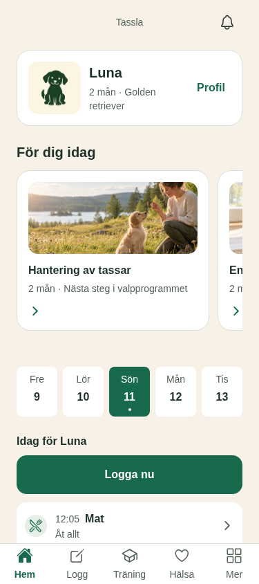
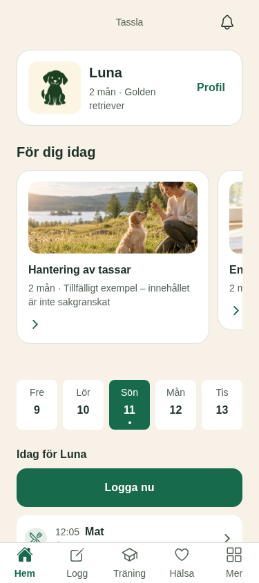
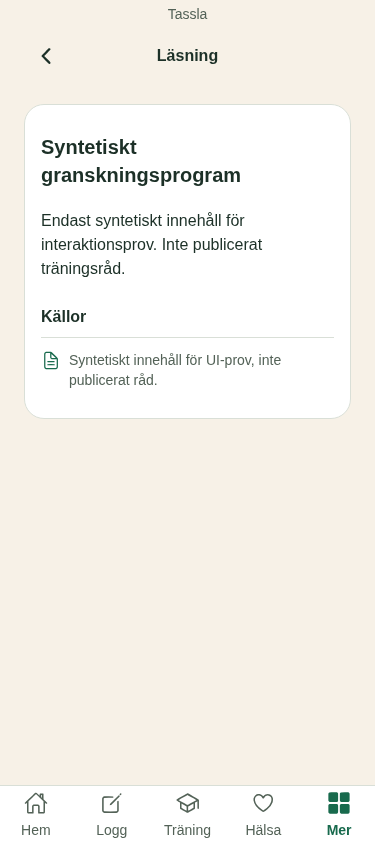
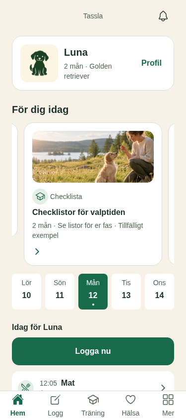

# HOME-NEXT-01 — Renderad evidens

Datum: 2026-10-12. Skärmbilderna är från React Native Web med syntetiska uppgifter; de verifierar inte nativebeteende, Supabase eller telefon.

Jämförelsebild: [vision_rev01.jpg](../../../../vision_rev01.jpg).

## Resultat

- Public och review UI-byggen: PASS. Home-kontrollerna passerar i båda lägena vid 375/430 px och 140 % text. Public saknar reviewträningens exempel och checklistkort; review visar checklistkortet, hela tillfälliga markeringen och rätt syntetisk destination.
- Fokuserat Node-test: 1/1 PASS. `pnpm check`: 37/37 PASS, lint 0 fel/38 varningar. Public iOS-bundle, `git diff --check` och kövalidering: PASS.
- Båda fulla `tools/visual-check/verify.py`-körningarna avslutas med exit 1 senare i ett äldre Kunskapsflöde: knappen “Läs Inför hemkomsten” hittas inte. Samtliga Home-kontroller har passerat före det felet.

## Designregler §14

| Punkt | Resultat | Notering |
|---|---|---|
| 1–15 | Ja | QA:s kontroll; renderade tillstånd, bredd och stor text ingår. |
| 16 | **Nej** | Hemmets befintliga carousel kommer före datumremsan och dagslistan, till skillnad från målbilden. |
| 17 | **Nej** | Hemmets varumärke är centrerat i stället för målbildens vänsterställda Tassla-brand. |
| 18 | Ja | Hundens namn visas med tillåten vänlig platshållarbild. |

Checklistans regel säger att ett Nej underkänner. Därför var v6:s visuella QA **UNDERKÄND**, även om ändringen höll sig till kortens tillgänglighet. Layout- och appbaravvikelser var utanför det då godkända kortpaketet. Erik utökade därefter mandatet till Hem i `vision_rev02.jpg`; v7-planen inväntar Architect/Critic-review. Den här mappen är bevarad som v6-baslinje.

## Filer

`public-*.png` visar publicläget med reviewflaggan av. `review-*.png` visar reviewläget med flaggan på. Paren `home-ready` täcker 375/430 px och 140 % text; övriga filer täcker tillstånd, kort av/på och reviewdestination. Full QA-output finns kvar i `/tmp/tassla-home-next-01/{public,review}`.
