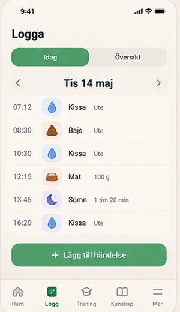
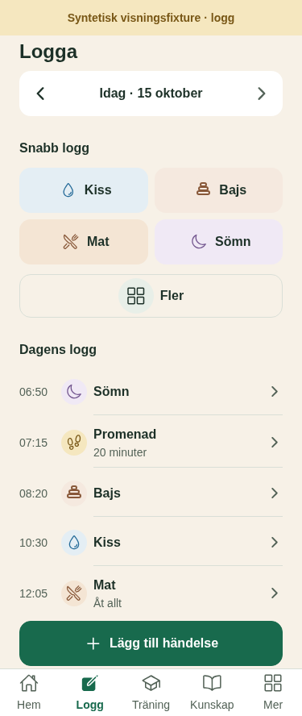

# UX-LOG-EDITOR-01 — panel 5 render och granskning

## Underlag

- Rev02-mål: [vision_rev02.jpg](../../../../../../vision_rev02.jpg), panel 5. Utskuret jämförelseunderlag: [reference-panel-5.png](reference-panel-5.png).
- Produktkod: `src/features/puppy-log/LogScreen.tsx` och opt-in-varianterna i `ListRow`, `IconChip` och `BottomSheet`.
- Revision: arbetsbas `e4759e6` plus oredigerade ändringar i denna arbetskopia; ingen commit skapad.
- Datum: 2026-10-15.
- Render: Chromium / React Native Web, syntetisk loggfixtur. Klockan låst till 2026-10-15 18:00 UTC så samtliga exempel ligger före nu och editorns framtidsvalidering inte påverkar bilderna.
- Appviewport 375×844, 430×844 och 375×667. Fixturemarkeringen är 44 px ovanför appviewport och ingår i respektive export (`888`, `888` respektive `711` px total höjd). 140 % är en webblayoutproxy, inte native Dynamic Type.

## Direkt jämförelse

| Rev02 panel 5 | Produktkomponent, public-fixture |
|---|---|
|  |  |

Referensen är en sammansatt visionsbild vars panel har annan pixelhöjd än en RN Web-viewport. Jämförelsen behåller originalpanelens bildförhållande; viewportmåtten och fixturemarkeringen ovan beskriver den aktuella rendern. V2.1:s ägarbeslutade avvikelse är den synliga gruppen med befintliga snabbval efter datumraden. Översiktsegmentet visas inte eftersom den andra vyn ännu inte finns; `Lägg till händelse` kompletterar snabbvalen efter tidslinjen.

## §14 — implementerarens bedömning

| # | Status | Underlag / motivering |
|---|---|---|
| 1 | Ja | Snabbvalen är en jämställd grupp; en enda grön primärknapp ligger efter tidslinjen. Spara är primärhandling i editorn. |
| 2 | Ja | Snabbvalsrutor har samma storlek; radera och avbryt är separata sekundärhandlingar i editorn. |
| 3 | Ja | Radera har destruktiv stil och bekräftelse. Undo gäller den befintliga bekräftade snabbregistreringen; deletion erbjuds inte som undo. |
| 4 | Ej tillämpligt | Regeln gäller Hem-rader. |
| 5 | Ja | Tokenavstånd, naturlig scroll och appens fasta bottennavigation används. Vid 375×667 kan CTA nås med scroll; editor-Spara ligger kvar i sheet-footer. |
| 6 | Ja | Tidslinje, ikonfärger, sheet och storlekar använder namngivna tokens och delade opt-in-varianter. CTA-formen följer den befintliga primärknappens tokens. |
| 7 | Ja | Ikoner hålls i den gemensamma IconChip-familjen. Radfärgerna är semantiska för Kiss, Bajs, Mat, Sömn och Olycka. |
| 8 | Ja | Varm canvas och ljusa kategoriytor syns. Mätt textkontrast: CTA 6,55:1; kategorisymbolerna Kiss 4,97:1, Bajs 5,03:1, Mat 4,86:1, Sömn 5,19:1; snabbvalstext minst 11,88:1. |
| 9 | Ja | Plusknappen öppnar kompletterande inmatning; varje kategoriikon/etikett motsvarar den valda loggtypen. Legacy-okänd olycka har en frågesymbol och uttrycklig hjälptext. |
| 10 | Ja | Vanliga poster saknar sparstatusbadge. Bockar förekommer inte i tidslinjen. |
| 11 | Ja | Bekräftelse/återhämtning använder befintlig toast; ingen ny hundreaktion eller uppmuntran har lagts till. |
| 12 | Ja | Svenska ord beskriver handlingen; legacy-hjälpen säger att typen saknas på den äldre posten. |
| 13 | Ja | Tid står i en fast vänsterkolumn; symbol, namn och eventuell kort metadata har tydlig hierarki. Anteckningarna kan radbrytas. |
| 14 | Ja för webflödet | Ren, tom, laddande, läsfels-, delvis sidfels-, pending-, sparad-, failed-, unsure- och retrylägen renderades. Raderingsvalen Avbryt/Radera hanterades via Alert-harnessen; native dialogvisning är inte renderad. |
| 15 | Web PASS; native NOT TESTABLE | RN Web-roller/etiketter och 44/56 px-kontroller finns; större textproxy och spar-footer kontrollerades. Native skärmläsare, keyboard/safe area, Dynamic Type och reduced-motion-inställning verifieras inte i Chromium. |
| 16a — komposition | Ja, med dokumenterad avvikelse | Titel → datum → befintliga snabbval → tidslinje → grön `Lägg till händelse`, enligt reviderat panel 5-kontrakt. Snabbvalsgruppen är en uttrycklig v2.1-avvikelse från visionsbilden. |
| 16b — färger | Ja | Varm bakgrund, lågmälda ytor och färgade kategorisymboler. Matens beige/bruna färg är opt-in för loggraden. |
| 16c — typografi | Ja | Titel, sektionsrubrik, händelsenamn, tid och metadata följer befintlig typografisk skala; långa värden växer med naturlig scroll. |
| 16d — komponentformer | Ja | Grupperade rader med tunna avdelare, avrundade snabbval och en tydlig grön primärknapp; ingen fristående kortbakgrund per händelserad. |
| 16e — objekt | Ja för fixture; produktdata NOT TESTABLE | Samma `LogScreen` används i produktflödet. Renderingens händelser är syntetiska, inte lästa från ett konto eller Supabase. |
| 16f — innehållstäthet | Ja, inom v2.1-kontraktet | Fem tidslinjerader och snabbval visas i jämförelseskärmen. Längre historik scrollas; designreglerna kräver inte att all historik ryms. |
| 16g — bildspråk | Ej tillämpligt | Panel 5 innehåller inga fotografier eller illustrerade bilder. |
| 17 | Ja | Logg är vald huvudflik. Översiktsegment saknas tills den vyn är byggd; ingen dekorativ eller falsk navigering renderas. |
| 18 | Ej tillämpligt | Panel 5 saknar hundporträtt. |

Den reviderade visningen motsvarar panelens ordning och semantiska tidslinje. Den ursprungliga quick-log-resan består enligt v2.1; detta är den dokumenterade visuella skillnaden mot den fristående referenspanelen.

## Skärmbilder

- `public/` och `review/`: tidslinjen vid 375×844, 430×844 och 375×667. Review-banner är utanför appviewport och syns i bilden.
- `public/add-event-sheet-375x844.png`: kompletterande loggtyper nås med CTA efter tidslinjen.
- `public/add-event-walk-selected-sheet-closed-375x844.png`, `add-event-accident-selector-only-375x844.png`, `add-event-duplicate-dialog-sheet-closed-375x844.png` och `add-event-duplicate-confirmed-sheet-closed-375x844.png`: val av vanlig typ stänger tilläggsarket; Olycka visar endast olycksselectorn; dubblettdialogen och dess bekräftade tillägg visas utan tilläggsarket.
- `public/editor-mat-375x844.png`, `editor-mat-430x844.png`, `editor-mat-375x667.png`: datum, tid, anteckning och förankrad Spara-footer.
- `public/editor-accident-pee-375x844.png` och `editor-accident-pee-375x844-text-140.png`: olycksredigering och 140 %-proxy.
- `public/editor-legacy-toggle-roundtrip-375x844.png` och `editor-legacy-saved-null-375x844.png`: `NULL` behålls när typen växlas från Olycka till Kiss och tillbaka, och efter sparning/återöppning.
- `public/quick-log-undo-375x844.png`, `editor-delete-action-375x844.png`, `editor-delete-confirmed-375x844.png`, `editor-failed-retry-saved-375x844.png`: snabbregistrering/undo, radera/avbryt/bekräfta och failed/retry.
- Övriga accident pee/poop/båda/okänd-, pending-, saved-, unsure-, tom-, laddnings-, läsfels- och partiellt läsfelsbilder finns i `public/`.

## Kontroller och gränser

- Scoped ESLint för ändrade TS/TSX-filer: PASS.
- RN Web-byggen: public PASS, review PASS.
- `pnpm typecheck`: stoppas endast av befintligt, orelaterat fel `src/components/ui/Motion.tsx:61` (`hovered` saknas i `PressableStateCallbackType`).
- Manuell Chromium: båda fixturelägena vid tre viewportstorlekar; kompletterande sheet; quick-log/undo; legacy toggle + spara/återöppna; radera/avbryt/bekräfta; failed/retry; 140 %-proxy med synlig Spara; inga `pageerror`.
- Alert-harnessen registrerar valen Avbryt/Radera och anropar dem. Native alertens utseende och native keyboard/safe-area/screen reader är NOT TESTABLE.
- Statisk Security-review: PASS. Ingen ny datainsamling, persistent lagring, behörighet eller logg-write-path infördes; befintlig skriv-/återhämtningsväg består.
- Oberoende QA: PASS efter uppdaterad granskning av CTA, befintliga supplemental-typer, legacy `NULL`-växling/sparning och evidensmatris. Native keyboard/safe area, VoiceOver, Dynamic Type och reduced motion kvarstår som NOT TESTABLE.
- Förnyad delta-QA efter första Reviewer-fyndet: PASS för vanlig typ, Olycka, dubblettdialog och bekräftad dubblett. Gemensam `selectType`-väg stänger nu tilläggsarket; fyra Chromium-bilder visar stängt ark vid respektive resultat. Scoped ESLint för `LogScreen.tsx` och nya public/review-byggen passerar; inga page errors. Inga testsviter kördes.
- Inga testsviter, live-data, databaser, migrationer, commits, pushar eller distribution kördes.
- Första oberoende Reviewer gav BLOCK: supplemental-arket kunde ligga kvar över olycks- eller dubblettflödet. Korrigeringen, delta-QA PASS och förnyad oberoende Reviewer PASS är nu klara; queue markerar `UX-LOG-EDITOR-01` som `done`. Native keyboard/safe area, VoiceOver, Dynamic Type och reduced motion är fortsatt NOT TESTABLE.
