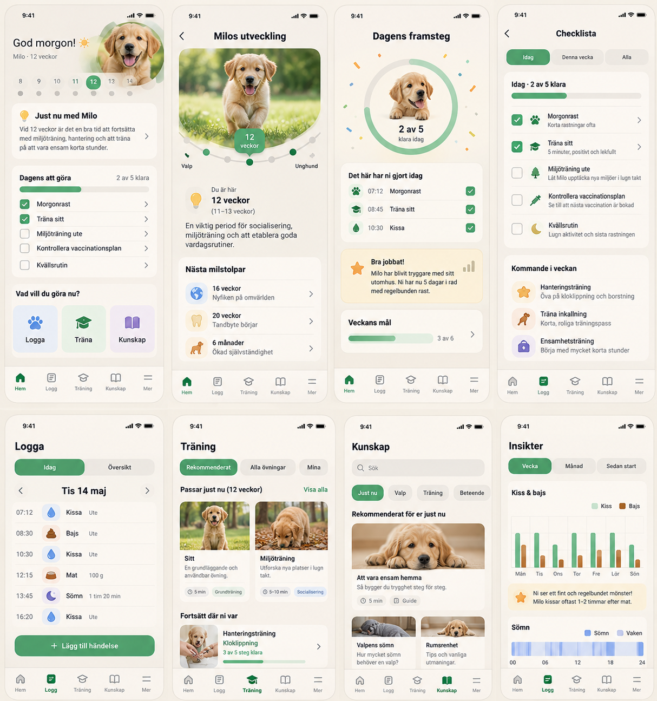
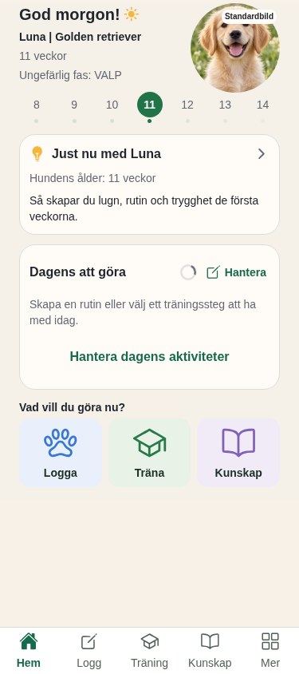

# UX-WORKSPACE-RETENTION-01 — Home/Training snapshot och rendergranskning

## Underlag

- Målbild: [vision_rev02.jpg](../../../../../../vision_rev02.jpg), panel 1 Home och panel 6 Training.
- Produktkod: `ProductWorkspace.tsx`, `HomeScreen.tsx`, `workspace-data.ts`; Home och Training renderas med sina produktionskomponenter.
- Revision: `e4759e6af5d58fa75e332ff1939652a835ba8af2` plus oredigerade lokala ändringar; arbetsgrenen är `codex/ux-rethink-2026-10-15`. Ingen commit skapad.
- Datum: 2026-10-15.
- Public och review byggdes separat med React Native Web; Chromium viewport 375×844 CSS px, skala 1. Reviewmarkeringen ligger utanför den 844 px höga appviewporten.
- 20-resors request trace är en lokal, syntetisk körning av samma `workspaceSnapshotReadDecision` som produktkoden använder. Den använder endast fixture-scope och gör ingen Supabase-läsning.

## Direkt jämförelse

| Rev02 panel 1 | Home under bakgrundsrefresh |
|---|---|
|  |  |

Referensen visar en sammansatt skärmbild; den vänstra första panelen är Home. Denna slice ändrar inte Home-kompositionen eller Training-innehållet. Home behåller sin panelordning och varma ytor, blå/gröna/lila genvägar samt bildens synliga `Standardbild`-roll. Vid uppdatering visas en diskret indikator bredvid dagens rubrik. Vid läsfel ligger bekräftade dagsrader kvar och ett svenskt felmeddelande med retry visas ovanför dem.

## §14 — implementerarens bedömning

| # | Status | Underlag / motivering |
|---|---|---|
| 1 | Ja | `Hantera` är den befintliga dagskorthandlingen; retry visas endast vid refreshfel. |
| 2 | Ja | Indikatorn är sekundär och ändrar inte knapphierarkin. |
| 3 | Ej tillämpligt | Ingen radering eller destruktiv handling ändras. |
| 4 | Ja | Dagsraderna behåller en tydlig fördjupning; hantering sker via befintlig `Hantera`-väg. |
| 5 | Ja för webviewport | Samma Home-layout och bottennavigation; native safe area är NOT TESTABLE. |
| 6 | Ja | Indikatorn använder RN `ActivityIndicator`; retry använder delad `Button`; ingen lokal färg-/formtoken infördes. |
| 7 | Ja | Befintliga Ionicons och delade navigationssymboler är oförändrade. |
| 8 | Ja | Panelens varma ytor och blå/gröna/lila destinationsfärger är oförändrade. Refreshindikator och hjälptext använder befintlig dämpad textfärg. |
| 9 | Ja | `Dagens uppgifter uppdateras` motsvarar indikatorn; feltexten säger att senast hämtade uppgifter visas; knappen försöker hämta igen. |
| 10 | Ja | Endast bekräftad snapshot renderas som dagsstatus. Fixture med okänd initial data visar ingen fabricerad total. |
| 11 | Ja | Ingen ny uppmuntran eller slutsats introduceras. |
| 12 | Ja | Fel- och retrytext är vardaglig svenska. |
| 13 | Ja | Samma titel, sektioner och datarader; refreshmeddelandet ligger i dagskortets läshierarki. |
| 14 | Ja för webflödet | Public/review visar ready, bakgrundsrefresh, refreshfel med retry, initial loading, tomt läge och okänt läsfel. Training ready renderades separat. |
| 15 | Web PASS, native NOT TESTABLE | Refreshindikator har svensk accessible label och retry är en knapp. Native VoiceOver, Dynamic Type, safe area och reduced motion verifieras inte i Chromium. |
| 16a — komposition | Ja | Home-panelens befintliga komposition är bevarad; ingen ny sektion utanför dagskortet. |
| 16b — färger | Ja | Befintliga panel 1-tokenytor och destinationsfärger är oförändrade. |
| 16c — typografi | Ja | Dämpad hjälptext använder befintlig captionstil; övrig Home-/Training-typografi oförändrad. |
| 16d — komponentformer | Ja | Kort, rader, knapp och bottennavigation är befintliga delade komponenter. |
| 16e — objekt | Fixture PASS; produktdata NOT TESTABLE | Produktionskomponenter renderas, men kontodata och Supabase/RLS används inte i visuell harness. |
| 16f — innehållstäthet | Ja för fixture | Fem dagsrader finns kvar under refresh och fel; felet tränger inte undan listan. |
| 16g — bildspråk | Ja | Befintligt generiskt standardporträtt och dess etikett är oförändrade. |
| 17 | Ja | Hem/Träning/Kunskap-labels och aktiv Home/Training-flik renderades. Request trace kör 20 varma Home → Training → Knowledge → Home-varv. |
| 18 | Ja | Home-fixture visar namn, ras och synlig Standardbild-etikett utan att koppla porträttet till en verklig hund. |

## Request trace

`public/REQUEST-TRACE.md` och `review/REQUEST-TRACE.md` innehåller de 20 spårade resorna. I vardera läge blev resultatet två initiala fixture-läsningar (Träning och dagens data), en delad träningsläsning och 40 cacheträffar över de 20 varven. Inga ytterligare fixture-läsningar startades under warm trips. Detta är verifiering av cachebeslutsregeln med syntetisk scope och inte uppmätta produktnätverksanrop.

## Skärmbilder

- `public/` och `review/`: `warm-20-tab-trips-375x844.png` samt `warm-20-tab-trips-bottom-375x844.png` visar request trace; `home-refreshing-375x844.png` och `home-refresh-error-375x844.png` visar bekräftade dagsrader under refresh och fel; `home-loading-375x844.png`, `home-empty-375x844.png` och `home-error-375x844.png` visar laddning, tomt och okänt initialt felläge; `training-ready-375x844.png` visar public/review Training.
- Alla fem public/review-rutter renderades med Chromium utan `pageerror`. Browserkontroller fann refreshlabel, retryknapp, 20 varv, 40 cacheträffar och inga fabricerade dags-totaler vid initialt fel.

## Kontroller och gränser

- ESLint för `ProductWorkspace.tsx`, `HomeScreen.tsx`, `workspace-data.ts` och `tools/visual-check/app.tsx`: PASS.
- RN Web-byggen: public PASS, review PASS.
- `git diff --check`: PASS. `python3 tools/dev_flow.py validate`: PASS med slice i `qa`-handoff.
- `pnpm typecheck`: blockeras endast av befintligt, orelaterat fel `src/components/ui/Motion.tsx:61` (`hovered` finns inte på `PressableStateCallbackType`).
- Ingen testsvit, Supabase, migration, live ägardata, commit, push eller distribution kördes.
- Implementerens statiska scope-inspektion: cacheminnet finns endast i `ProductWorkspace`; scope omfattar konto, kontogeneration, hund, ras/ålderurval, dag, tidszon och public/review-läge. Scopebyte aborterar läsning och rensar state före ny synlig vy; generationer skyddar mot sena svar; bekräftade writes supersederar äldre läsningar. Ingen persistent cache eller telemetri infördes.
- **Oberoende QA, separat Security-review och Reviewer-signoff återstår.** Dessa är obligatoriska innan checkpointen kan markeras `done` och punkt 5 startas.
